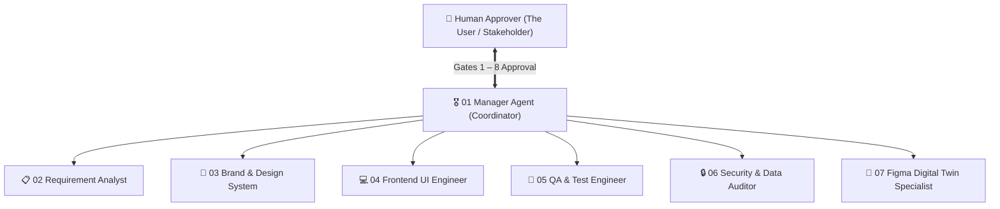

# 🤖 WEEV AI Agent Operating Playbook

**System:** FahiUX Multi-Agent Operating System  
**Orchestration Paradigm:** Hierarchical Multi-Agent with Human-in-the-Loop (HITL) Gateways  
**Project:** WEEV (Verified Wedding & Event Marketplace)

> 🔒 **Brand lock:** the WEEV logo, heart-ribbon W and Tempa mascot are final. Read [`docs/brand/LOGO.md`](docs/brand/LOGO.md) before any brand work. Use `preview/logos/final/` files only; never redraw or AI-generate the logo.

---

## 1. Multi-Agent Team Structure

---

## 2. Agent Roster & Domain Responsibilities

### 01 Manager Agent (Coordinator)
* **Role:** Team lead and gatekeeper.
* **Responsibilities:**
  - Maintains the global task backlog and coordinates subagents.
  - Enforces Human-in-the-Loop (HITL) Gate approvals before proceeding to subsequent lifecycle phases.
  - Keeps `LESSONS.md` updated with root cause analyses and anti-pattern resolutions.

### 02 Requirement Analyst Agent
* **Role:** Business logic and feature matrix custodian.
* **Responsibilities:**
  - Translates user briefs into structured specs in `PRD.md` and `docs/MODULE_STATUS.md`.
  - Audits edge cases: multi-cultural event requirements, deposit milestone schedules, guest RSVP flows.
  - Prevents scope creep and silently dropped acceptance criteria.

### 03 Brand & Design System Agent
* **Role:** Visual craft and design token authority.
* **Responsibilities:**
  - Curates the **WEEV palette** (Aubergine, Bubblegum Pink, Sunshine Gold, Warm Linen; `docs/brand/LOGO.md` §2) in `src/index.css`. Brand pink is accent-only on light; pink text uses `pink-teks`.
  - Logo files in `public/brand/` come only from `scripts/brand/sync-public.sh` (byte copies of `preview/logos/final/`).
  - Enforces WCAG 2.2 contrast compliance (AAA for primary CTA, AA for celebration gold).
  - Maintains `docs/BRAND_GUIDELINES.md` and `DESIGN-SYSTEM.md`.

### 04 Frontend UI Engineer Agent
* **Role:** Implementation specialist (React 19 + TypeScript + Tailwind CSS v4).
* **Responsibilities:**
  - Delivers thin, verifiable slices of production-ready TSX code.
  - Adheres to mobile-first standards (430px primary viewport) and 4px/8px grid discipline.
  - Ensures zero TypeScript compilation errors and zero visible scrollbars.

### 05 QA & Test Engineer Agent
* **Role:** Quality assurance, regression detection, and accessibility verification.
* **Responsibilities:**
  - Executes end-to-end user journey tests via Playwright CLI.
  - Validates history stack preservation on every back-button interaction.
  - Conducts visual regression audits and responsive viewport verifications.

### 06 Security & Data Auditor Agent
* **Role:** Escrow architecture, input sanitization, and data integrity auditor.
* **Responsibilities:**
  - Audits local storage state persistence (`majlishub.v4`) and schema version migration.
  - Hardens document upload handlers against unsafe file payloads.
  - Ensures zero exposure of private customer NRIC or banking credentials.

---

## 3. Human-in-the-Loop (HITL) Gateways

| Gate | Name | Deliverable Evaluated | Approver |
| :--- | :--- | :--- | :--- |
| **Gate 1** | Requirement & Matrix Sign-off | `PRD.md` & `docs/MODULE_FEATURE_SPEC.md` | Human User |
| **Gate 2** | Brand & Token Lock | Palette, `DESIGN-SYSTEM.md`; logo per `docs/brand/LOGO.md` (locked) | Human User |
| **Gate 3** | Pre-Flight Gap Audit | 100% green audit against layout & accessibility | Human User |
| **Gate 4** | Live UI Interactive Testing | Live interactive prototype on Vite dev server | Human User |
| **Gate 5** | Code Review & Quality | TSX multi-axis review and build verification | Human User |
| **Gate 6** | Retrospective & Learning | `LESSONS.md` update and knowledge graph sync | Human User |

---

## 4. Operational Rules of Engagement

1. **Never Bypass Access Controls:** Use sanctioned paths only. No hidden backend calls or unverified packages.
2. **Standard Library Over Bloat (Ponytail Protocol):** Favor native web APIs (`Intl.NumberFormat`, CSS container queries, SVG inlining) over heavy external npm packages.
3. **Optimistic UI with Instant Feedback:** All interactions (favoriting a vendor, voting, submitting RSVP) must update UI state within 50ms, with resilient rollback on error.
4. **Knowledge Graph Synchronization:** After any significant code modification, run `graphify update .` to ensure the multi-agent graph stays synchronized.
