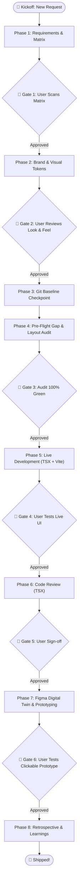

# 🏛️ FahiUX Multi-Agent Operating System (Workflow Playbook)

This project operates under a strict **Hierarchical Multi-Agent Architecture** with **Human-in-the-Loop (HITL) Gateways**. 
No agent may jump to a subsequent phase without explicit approval from the Human User (The Boss).

---

## 🚦 Rules of Engagement
1. **The Human is the Sole Approver:** Only the User can grant approval at any Gate. Agents must never sign off on their own work.
2. **The Manager Conducts, Specialists Build:** The Manager Agent orchestrates, assigns tasks, and enforces gates. Specialist agents execute their domain tasks.
3. **No Code Before Spec & Audit:** Implementation only begins after the Module & Feature Matrix, Brand Guidelines, and Pre-Flight Audit have passed.
4. **Live Dev Server Always On:** Development runs against a live Vite dev server (`localhost:5173`) with zero tolerance for build errors.
5. **Continuous Learning:** Every session ends with lessons logged to `LESSONS.md` to prevent repeated mistakes.

---

## 🗺️ Master Lifecycle Pipeline

---

## 📋 Phase Breakdown & Protocols

### Phase 1: Requirements & Feature Matrix
* **Agent in Charge:** `02_requirement_analyst_agent.md`
* **Trigger:** Manager receives user request.
* **Protocol:**
  1. **Visual Asset Ingestion:** The agent immediately prompts:
     > *"Do you have any reference sketches, wireframes, or photos you'd like to share? Please provide file paths or images."*
  2. **Codebase Inspection:** Scans existing repo structure, models, dependencies, and routing.
  3. **Module & Feature Matrix Generation:** Builds `docs/MODULE_FEATURE_SPEC.md` using `templates/MODULE_FEATURE_SPEC_TEMPLATE.md` adhering to the **6 Enterprise Pillars** (Traceability IDs, 5 Screen States, RBAC, Data Dictionary, Gherkin Criteria, Non-Goals).
* 🛑 **GATE 1:** Manager presents matrix summary. User reviews and signs off (*"Ok or not?"*).

---

### Phase 2: Brand Guidelines & Look-and-Feel
* **Agent in Charge:** `03_design_engineer_agent.md`
* **Skills Activated:** `design-taste-frontend`, `brandkit`, `high-end-visual-design`
* **Protocol:**
  0. **Design System & Style Selection (Pre-Phase 2 Prompt):**
     - Before writing guidelines, the Manager Agent:
       1. Shows the user the **full live catalog** from [awesome-design-md](https://github.com/voltagent/awesome-design-md/tree/main/design-md) (~75 brands) — never a silently pre-filtered shortlist.
       2. Fetches the **real `DESIGN.md` description** for 3-5 candidates that fit this project's domain and recommends one, with reasoning tied to the project (not brand reputation or memory — the real doc can contradict a brand's public image).
       3. Lets the user confirm, override, paste a custom reference, or describe a vibe instead.
       4. Once chosen, **clones the actual `design-md/<brand>/DESIGN.md` and `README.md`** into `docs/design-reference/` in this project (via `curl`/raw GitHub URLs — never a paraphrase), commits, and pushes.
  1. **Brand System Definition:** Ingests the **cloned** `docs/design-reference/DESIGN.md` and generates `docs/BRAND_GUIDELINES.md` using `templates/BRAND_GUIDELINES_TEMPLATE.md`.
     - Corner radius hierarchy (outer cards, inner elements, pills).
     - Border strokes (1px subtle alpha, 1.5px/2px active states).
     - Spatial rhythm (4px/8px multiples, container max-widths).
     - Editorial typography pairings and tight tracking.
     - Semantic icon mapping via Iconify for Lucide React.
  2. **Concept Mood Board:** Builds `preview/moodboard.html` — imagery, texture, tone, and adjectives conveying the *feeling* before anything becomes a spec. **Hard rule: every reference image must be either AI-generated or verified royalty-free/freely-licensed stock — never an arbitrary copyrighted image.** Generate with an image tool if this session has one; otherwise source real royalty-free photos (attributed, license verified, URL-verified). Never ship an all-abstract collage silently in place of photography, and never claim generation happened if it didn't.
  3. **Design Token / Style Guide:** Builds `preview/design-tokens.html` — the implementable spec page: color palette swatches, an explicit font-family specimen block per typeface (not buried in the scale table), full typography scale, every button/form-field/badge/KPI-card variant, and the icon grid. This is the *only* place token swatches belong.
  4. **Visual Prototype Preview:** Builds `preview/prototype.html` as a live, interactive simulation of the **actual product interface** (e.g. real operational screens, core transactional journeys, multi-state transitions).
     - *Anti-Pattern Warning:* Never let the prototype collapse into a "Token Showcase" page — that's the design-tokens page's job, not the prototype's.
     - *Anti-Pattern Warning:* If given a reference project, extract the craft bar and polish—never clone fonts or layouts 1:1.
* 🛑 **GATE 2:** User reviews the mood board (direction/feeling), the design-tokens page (spec at a glance), the interactive product flow, and the brand guidelines doc together. User approves.

---

### Phase 3: Git Baseline Checkpoint
* **Agent in Charge:** `01_manager_agent.md`
* **Protocol:**
  1. Clean and organize project files into proper directories:
     - `/docs` for specifications and guidelines.
     - `/preview` for prototype assets.
     - `/.agents` for workflow configurations.
  2. Verify git status and stage all baseline documentation.
  3. Commit: `chore: establish requirements matrix and brand guidelines baseline`.
  4. Push to remote repository (`origin/main`).

---

### Phase 4: Pre-Flight Gap & Layout Audit
* **Agent in Charge:** `04_preflight_auditor_agent.md`
* **Skills Activated:** `figma-standard-ui`
* **Protocol:**
  1. **Feature Coverage Scan:** Cross-references the HTML prototype against every `FEAT-XX` in `MODULE_FEATURE_SPEC.md`. Confirms zero missing features.
  2. **5-State Verification:** Verifies Empty State, Loading skeleton, and Error handling exist.
  3. **Auto-Layout & Spacing Audit:** Checks flex/grid properties, Hug/Fill constraints, and eliminates arbitrary pixel margins.
* 🛑 **GATE 3:** Audit report outputs 100% green with zero unresolved blockers. User confirms proceeding to code.

---

### Phase 5: Live Development (Vite + TSX)
* **Agent in Charge:** `05_coding_agent_tsx.md`
* **Skills Activated:** `figma-standard-ui`, `design-taste-frontend`
* **Stack:** React 19 + Vite 6 + Tailwind CSS v4 + Lucide React
* **Protocol:**
  1. Dev server runs continuously at `http://localhost:5173`.
  2. Decomposes screens into clean, modular components under `src/components/`.
  3. Uses strict design tokens from `BRAND_GUIDELINES.md` (no arbitrary pixel classes).
  4. Runs TypeScript build verification (`npm run build`). Must have **0 errors**.
* 🛑 **GATE 4:** User tests running application live in the browser. User approves.

---

### Phase 6: Code Review (TSX Quality & Security)
* **Agent in Charge:** `06_code_reviewer_tsx.md`
* **Protocol:**
  1. Audits git diff against:
     - TypeScript cleanliness: Zero `any`, complete interface definitions.
     - Token compliance: Zero rogue pixel values or untracked Tailwind hacks.
     - React best practices: Correct hook dependencies, no redundant re-renders.
     - Accessibility: Semantic HTML (`<button>`, `<main>`, `<nav>`), ARIA labels on icon buttons.
  2. Produces structured report: `[BLOCKER]`, `[WARNING]`, `[SUGGESTION]`.
* 🛑 **GATE 5:** User reviews findings. Blocker items patched. User grants final sign-off.

---

### Phase 7: Figma Digital Twin & Interactive Prototyping
* **Agents in Charge:** `07_figma_ai_agent.md` (builds), `08_retro_agent.md` (logs every user correction as a rule)
* **Skills Activated:** `figma-standard-ui`, `figma-use`
* **Protocol:**
  1. **State Inventory & Capture:** Every tab, toggle, accordion, view mode, drawer and modal gets its own frame. Captures at 1440px from the live dev server (restarted after code edits). Cold-cache defense: `VECTOR` count > 0.
  2. **Sweep & Repair:** `figma-sweep.js` on every capture, then the `figma-standard-ui` repair checklist page-wide (code-faithful: read the TSX class first). Badge overlays stay absolute.
  3. **Clone & Slot:** One header component per module (instances on every screen); sidebar fills the height and shows the selected item.
  4. **Prefix Naming & Sectioning:** `[MM].[SS] - [Description]`, one section per feature, frame gap 500, orthogonal links.
  5. **1:1 TSX Prototyping Wiring:** From the TSX handlers; DISSOLVE 150 ms EASE_IN_AND_OUT; overlays for panels/modals.
  6. **Review Loop:** User reviews screen by screen; each correction → Retro Agent rule → applied page-wide on every module.
  7. **Final Audit & Verify:** wiring (every frame reachable), content = TSX, layout verified (gaps, no diagonal links, nothing clipped).
* 🛑 **GATE 6:** User tests the clickable interactive Figma prototype.

---

### Phase 8: Retrospective & Continuous Learning
* **Agent in Charge:** `01_manager_agent.md`
* **Protocol:**
  1. Audits friction points, manual interventions, and bugs discovered during the session.
  2. Logs learnings into `LESSONS.md` using `templates/LESSONS_TEMPLATE.md` (starting from the Retro Agent's `docs/retro.md`).
  3. If necessary, patches rules in `.agents/` or `WORKFLOW.md` so the mistake is never repeated.
  4. Proposes updates to the global skills (`figma-standard-ui`, this blueprint) with the user's approval, so the next project starts with the lesson.
